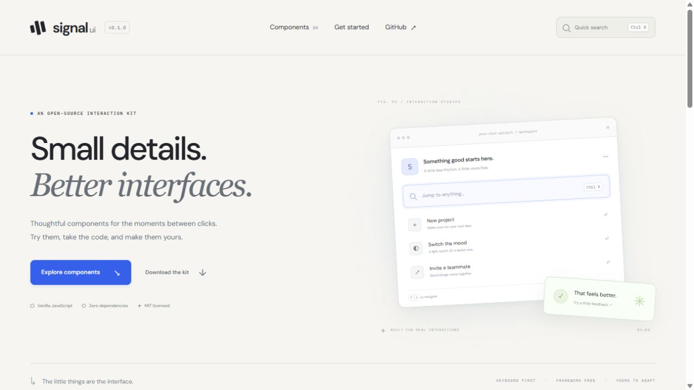

# Signal UI

Small, reusable interface components for plain HTML, CSS, and JavaScript.

Signal UI explores the details that help an interface feel clear: finding an action, moving between views, confirming a choice, and understanding what happened next. The kit brings those interactions together with shared styling and copyable examples.

**[Try the components](https://jupiter847.github.io/signal-ui-kit/)** · **[Download the kit](https://jupiter847.github.io/signal-ui-kit/downloads/signal-ui-kit.zip)**



## What is included

| Component | Useful for |
| --- | --- |
| Command menu | Finding and running actions without searching through navigation. |
| Tabs | Switching between related views while keeping the current context. |
| Dialog | Giving an important decision its own focused space. |
| Toasts | Confirming an action without interrupting the task. |

The components use native ES modules and one shared stylesheet. There are no runtime dependencies and no framework requirement. The kit is not published to npm; copy the source files into your project.

## Quick start

Copy `signal-ui.js` and `signal-ui.css` into your project. Save this example beside them and serve the folder over HTTP:

```html
<!doctype html>
<html lang="en">
  <head>
    <meta charset="utf-8" />
    <meta name="viewport" content="width=device-width, initial-scale=1" />
    <title>Signal UI example</title>
    <link rel="stylesheet" href="./signal-ui.css" />
  </head>
  <body>
    <button id="save-button" type="button">Save preferences</button>

    <script type="module">
      import { createToasts } from './signal-ui.js';

      const toasts = createToasts();
      const saveButton = document.querySelector('#save-button');

      saveButton.addEventListener('click', () => {
        toasts.show({
          title: 'Changes saved',
          description: 'Your preferences are up to date.',
          variant: 'success',
        });
      });
    </script>
  </body>
</html>
```

[`starter.html`](./starter.html) includes examples of all four components. Only the two library files are needed to add the components to your own project.

## Command menu

```html
<button id="open-command-menu" type="button">Find an action</button>

<script type="module">
  import { createCommandMenu } from './signal-ui.js';

  const menu = createCommandMenu({
    trigger: document.querySelector('#open-command-menu'),
    title: 'Find an action',
    placeholder: 'Search actions…',
    commands: [
      {
        id: 'new-project',
        label: 'New project',
        description: 'Start with an empty workspace',
        keywords: ['create', 'workspace'],
        onSelect: () => console.log('Create a project'),
      },
      {
        id: 'open-settings',
        label: 'Open settings',
        keywords: ['preferences'],
        onSelect: () => console.log('Open settings'),
      },
    ],
  });

  // Useful when the available actions change.
  // menu.setCommands(nextCommands);

  // Remove generated elements and event listeners on unmount.
  // menu.destroy();
</script>
```

Use **Ctrl/⌘ K** to toggle the menu, **↑/↓** to move through results, **Enter** to select, and **Escape** to close. After starting result navigation with an arrow key, **Home/End** move to the first or last enabled result. Before that, they retain their normal text-editing behaviour.

The global shortcut ignores unrelated editable fields and other open dialogs. It still closes this menu when its own search field is focused. Set `shortcut: false` if your application already uses Ctrl/⌘ K.

Command labels and descriptions are treated as text. Add `disabled: true` for an unavailable action. Each command needs a unique, nonempty string `id`; enabled commands also need an `onSelect` callback. Selection closes the menu before running that callback.

The optional per-command `shortcut` string is a visual label, such as `⌘ N`. It does not register another keyboard shortcut.

The returned controller provides `open()`, `close()`, `setCommands(commands)`, and `destroy()`. Cleanup removes generated elements and listeners and restores the trigger's original ARIA attributes.

## Tabs

```html
<div id="workspace-tabs">
  <div role="tablist" aria-label="Workspace views">
    <button
      type="button"
      role="tab"
      id="overview-tab"
      aria-controls="overview-panel"
      aria-selected="true"
    >Overview</button>
    <button
      type="button"
      role="tab"
      id="activity-tab"
      aria-controls="activity-panel"
      aria-selected="false"
      tabindex="-1"
    >Activity</button>
  </div>

  <section
    role="tabpanel"
    id="overview-panel"
    aria-labelledby="overview-tab"
    tabindex="0"
  >Project overview</section>
  <section
    role="tabpanel"
    id="activity-panel"
    aria-labelledby="activity-tab"
    tabindex="0"
    hidden
  >Recent activity</section>
</div>

<script type="module">
  import { createTabs } from './signal-ui.js';

  const tabs = createTabs(document.querySelector('#workspace-tabs'), {
    onChange: ({ id, panelId }) => console.log(id, panelId),
  });

  // Select by tab ID, not panel ID.
  // tabs.select('activity-tab');

  // tabs.destroy();
</script>
```

Tab IDs and panel IDs must be unique on the page. `aria-controls` connects each tab to its panel, and `aria-labelledby` gives each panel its tab's label.

Tabs use manual keyboard activation: **←/→** move focus, **Home/End** focus the first or last tab, and **Enter/Space** activate the focused tab. This lets someone explore the available views without loading each one as they move.

The returned controller provides `select(tabId)`, an `activeId` getter, and `destroy()`. `select()` changes the active tab without moving keyboard focus and returns whether the selection is valid. An optional `onChange` callback receives `{ id, panelId, tab, panel }` when the active selection changes; initialization and reselecting the active tab do not call it.

The controller adds its styling class automatically. `destroy()` removes its listeners and restores the original ARIA attributes, tab stops, and panel visibility.

## Dialog

```html
<button id="open-confirmation" type="button">Archive project</button>

<script type="module">
  import { createDialog } from './signal-ui.js';

  const confirmation = createDialog({
    trigger: document.querySelector('#open-confirmation'),
    title: 'Archive this project?',
    description: 'You can restore it from your archive later.',
    confirmLabel: 'Archive project',
    cancelLabel: 'Keep project',
    onConfirm: () => console.log('Archive the project'),
  });

  // confirmation.open();
  // confirmation.close();
  // confirmation.destroy();
</script>
```

The dialog uses the browser's native `<dialog>` element. It has a visible title, a close control, and separate confirm and cancel actions. **Escape** closes it. Focus returns to the control that opened it.

For additional content, pass an existing `HTMLElement` as `content`. It is moved into the dialog, not cloned. On `destroy()`, it returns to its original parent if that parent is still connected. Use text and DOM elements rather than injecting untrusted HTML.

Initial focus goes to an autofocus or interactive element in the content when present, otherwise to the cancel button.

The returned controller provides `open()`, `close()`, and `destroy()`. Confirmation closes the dialog before running `onConfirm`. Cancel, Escape, backdrop dismissal, and `close()` do not run the confirmation callback. The callback is not awaited; use it to connect your application's state and asynchronous work.

## Toasts

```js
import { createToasts } from './signal-ui.js';

const toasts = createToasts({
  position: 'bottom-right',
  duration: 4500,
});

const toastId = toasts.show({
  title: 'Project archived',
  description: 'It is still available in your archive.',
  variant: 'success',
  action: {
    label: 'Undo',
    onClick: () => console.log('Restore the project'),
  },
});

// Remove an individual message.
// toasts.dismiss(toastId);

// Remove the stack and its event listeners on unmount.
// toasts.destroy();
```

Available variants are `default`, `success`, and `error`. The default lifetime is 4,500ms. Set `duration` per message to override it, or use `duration: 0` for a persistent message. Messages with an action stay visible until dismissed unless an explicit duration is supplied.

Up to three messages are visible; additional messages wait in the queue. Timers pause on hover, keyboard focus, and while the page is hidden. Persistent messages occupy their slots until they are dismissed.

Supported positions are `bottom-right`, `bottom-left`, `top-right`, and `top-left`. On small screens, the stack uses the available width.

Use a toast for brief feedback. Put essential information and form errors next to the task or field they concern.

The returned controller provides `show(options)`, `dismiss(id)`, and `destroy()`. `show()` returns a unique message ID. `dismiss()` returns `true` when a visible or queued message was removed, otherwise `false`. After `destroy()`, `show()` returns `null`. Cleanup cancels timers and queued messages, removes generated elements, and removes the page-visibility listener.

## Filtering commands separately

`filterCommands(commands, query)` is also exported for reuse. It searches labels, descriptions, and keywords, matching every space-separated search term while ignoring case and diacritics. It returns a new array in the original order and leaves the supplied commands unchanged. Disabled commands remain eligible for matching; the command menu prevents them from being selected.

## Styling

The stylesheet prefixes component classes with `sg-` and exposes shared CSS custom properties. Override them in the scope where you use the components:

```css
:root {
  --sg-accent: #3667f8;
  --sg-accent-contrast: #ffffff;
  --sg-bg: #f5f4f0;
  --sg-surface: #ffffff;
  --sg-ink: #18191e;
  --sg-muted: #696b76;
  --sg-line: #dedfe5;
  --sg-radius: 18px;
  --sg-font: system-ui, sans-serif;
}
```

The components inherit the surrounding font by default; `--sg-font` can set it explicitly. `--sg-accent-contrast` controls text on the primary accent. Set theme variables on `:root` or another ancestor that also contains the generated overlays, since dialogs and toast stacks are appended to `document.body`. Check text contrast, focus visibility, and layout again when applying a custom theme.

## Integration notes

- Create each controller once for its mounted interface. Call `destroy()` before removing or replacing that interface.
- Keep command IDs, tab IDs, and panel IDs stable and unique.
- The command menu and dialog append their generated elements to `document.body`.
- This is browser-side code. Initialize it after the page elements exist, or from a client-side mount hook.
- The command menu and dialog require native `<dialog>` support. The source uses ES modules.

## Interaction details

The kit is designed around keyboard navigation, visible focus, meaningful labels, and text-based feedback. Dialogs use native modal behaviour, tabs connect their controls and panels through ARIA attributes, and transient feedback uses live-region announcements. Motion respects the reduced-motion preference.

These features are a starting point for accessible integration, not an accessibility certification. Review the components in the context of your own content and application.

## Run the demo and tests

From a local checkout, use Node.js and npm:

```sh
npm run dev
```

Open `http://127.0.0.1:4196/`. Run the Node tests with:

```sh
npm test
```

The library itself runs in the browser; Node is only needed for this local server and the test command.

## Version 0.1 scope

This is a small browser-side kit with four components. It uses ES modules, native `<dialog>`, and modern CSS including `color-mix()`. No dialog polyfill is bundled. Tabs use manual keyboard activation. There is no npm release or React adapter; use the source module directly and connect it to a framework's mount and cleanup hooks when needed.

The keyboard and ARIA decisions were informed by the [MDN dialog reference](https://developer.mozilla.org/en-US/docs/Web/HTML/Reference/Elements/dialog), [WAI-ARIA tabs pattern](https://www.w3.org/WAI/ARIA/apg/patterns/tabs/), and [combobox pattern](https://www.w3.org/WAI/ARIA/apg/patterns/combobox/).

## License

MIT © 2026 Janina. You can use, modify, and share the code, including in commercial projects. Keep the license notice with redistributed copies. See [LICENSE](./LICENSE).
